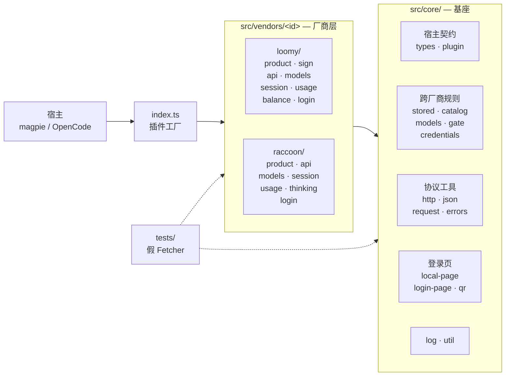
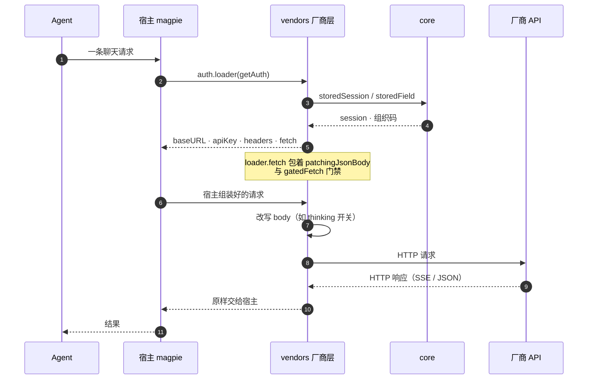

# opencode-cn-ai-auth

给 Magpie 与 OpenCode 的中国区 AI 编程订阅 provider 插件：Loomy（讯飞）与
Raccoon（商汤小浣熊），共享同一套协议实现。Magpie 使用一个包承载两个 provider，
OpenCode 使用每家厂商一个显式入口：

| provider id | 厂商 | 模型数（回退表） | Magpie 登录方式 |
|---|---|---|---|
| `loomy` | Loomy（讯飞） | 8 | 微信扫码 / 短信验证码 |
| `raccoon` | Raccoon（商汤小浣熊） | 6 | 微信扫码 / 短信验证码 |

包名 `opencode-cn-ai-auth`（本地开发 / 独立仓库）；将来贡献进 magpie-community
时用 `@magpie-community/opencode-cn-ai-auth`，目录 `packages/cn-ai`。
无运行时依赖、零构建：宿主 Bun 直接加载 TypeScript 源；Magpie 需要
`engines.bun >= 1.1.0`，OpenCode 子入口声明 `engines.opencode >= 2.0.0 < 3`。

## 安装

### magpie

```sh
magpie plugin add <包的路径或名字>
magpie plugin login loomy    # 或 raccoon
magpie plugin --json         # 看加载状态
```

### OpenCode

OpenCode V2 按厂商加载一个子入口；每个子入口导出标准的 `{ id, setup }` 插件对象。
这里的入口只支持 V2；V1 的函数/`server` loader 不会把它误当成 Magpie 插件：

```jsonc
{
  "plugins": [
    {
      "package": "opencode-cn-ai-auth/opencode/loomy",
      "options": { "accessToken": "<loomy-session-token>" }
    }
  ]
}
```

Raccoon 使用 `opencode-cn-ai-auth/opencode/raccoon`，并把 token 放进
`RACCOON_ACCESS_TOKEN` 或插件 `options.accessToken`。也可以把两个条目同时放入
`plugins`。适配器会注册回退模型目录、V2 integration 登录方式，并在请求中注入
token；二维码/短信登录会在 OpenCode 的本地登录页完成，凭据由 OpenCode 保存，
不会迁移 Magpie 的账号 metadata。Raccoon 组织账号请在插件 options 中提供
`officeIdentity`。Magpie 的完整额度卡片和签到能力只在 Magpie host 中生效；Raccoon
的自动续期只对返回 refresh token 的登录生效。

兼容矩阵：OpenCode V2 的 `plugins` 配置和 `setup(ctx)` 入口；OpenCode V1 的
`plugin` 配置及函数/`server` 入口不支持，需升级宿主或改用包根的 Magpie 入口。

Magpie 仍然从包根入口 `index.ts` 加载两个插件工厂；根入口和两个 OpenCode 子入口
都会随 npm 包发布。

## 登录

### Loomy

- 微信扫码：插件在 `127.0.0.1` 起一个一次性本地页，展示二维码与状态，扫码后长轮询微信。
- 短信验证码：另一个登录方式（另一张本地页），填写手机号接收验证码即可登录，不需要微信。
  「获取验证码」在验证码输入框右侧，点击后按钮进入 60 秒倒计时并禁用；同一个号码两次
  发送之间隔 60 秒，一次登录最多发 3 条；`options.smsLogin: false` 可关闭这一项。

### Raccoon

- 微信扫码：二维码由插件本地渲染成内联 SVG，本地页每 2 秒轮询一次扫码状态。
- 短信验证码：另一个登录方式（另一张本地页），阿里云滑块 + 手机号 AES-128-CFB 加密后提交；未配置 `phoneCipherSecret` 时这一项不出现。

## 可选登录配置

**讯飞账号 AccessKey（可选）**

- 选项键：`accessKeyId` / `accessKeySecret`
- 环境变量：`LOOMY_XFYUN_ACCESS_KEY_ID` / `LOOMY_XFYUN_ACCESS_KEY_SECRET`
- 微信扫码、首次扫码后的手机号绑定、独立短信登录都用随包提供的 Loomy 客户端公开常量，无需自行获取或配置 AccessKey。
- 这两项是**可选覆盖**：厂商若旋转了内嵌常量，用户可以填自己的，配了就用用户的。

**讯飞短信登录开关（可选）**

- 选项键：`smsLogin: false`
- 默认开启；关掉后 Loomy 只剩微信扫码登录。

**商汤手机号加密密钥**

- 选项键：`phoneCipherSecret`
- 环境变量：`RACCOON_PHONE_CIPHER_SECRET`
- 只被短信登录用到。
- 未配置时：短信方式不注册。

Raccoon 的 `phoneCipherSecret` 仍需用户按 [`docs/vendors.md`](docs/vendors.md) 的说明配置；
未配置时 Raccoon 的短信登录不注册。只有在要启用 Raccoon 短信登录、覆盖内嵌凭据或
关闭 Loomy 短信登录时，才需要使用下面的 Magpie 插件选项：

```sh
magpie plugin options <插件名> '{"accessKeyId": "…", "accessKeySecret": "…", "phoneCipherSecret": "…"}'
```

一个包的多个 provider 共享同一份 options，所以键名按厂商区分，不会互相覆盖。

## 能力对照

| 能力 | Loomy | Raccoon |
| --- | --- | --- |
| 模型目录 | 账号级 `GET /models`，倍率写在展示名里，插件把它解析成 `rate` 徽标；读不到时回退内置 8 个模型并标记为回退 | 账号级 `GET /model_catalog`，取 `type === "chat"` 且非 `visible: false`；倍率来自 `billing_multiplier` / `billing_effective_multiplier`，回退内置 6 个模型 |
| 思考档位 | 厂商自己的档位（`none` / `low` / `medium` / `high` / `xhigh`）直接映射到宿主 variants | 只有「开 / 关」两态，宿主词汇用 `high` / `none`，在请求体里写成 `extra_body.thinking.type = enabled` / `disabled`（厂商唯一有效的通道；`reasoning_effort` 实测无效，因此插件不会把它当档位用） |
| 用量卡片 | 三行：今日积分（参与选号）+ 永久积分（`aside`）+ 新手任务进度（`aside`，8/8 领完时不显示） | `GET /balance` 的 available / reward / daily / topup / monthly 分池展示；上限服务未公布，全部 `aside`（只展示，不参与选号） |
| 锁定永久积分 | `options.lockPermanent: true` 时，今日额度用完即拒绝请求（429，宿主把账号 bench 到窗口重置），不再悄悄花永久积分 | — |
| 每日签到 | 有：`POST /points/first-login`（幂等，返回当日额度），并在同一次签到里顺手补领没领完的**新手任务**（8 项 / 10000 分，纯 API 直领、不花模型 token；领完的账号零额外请求） | 没有：每日 300 积分由服务端自动发放、没有端点，因此插件不做签到 |
- **新手任务（Loomy）**：宿主没有一次性奖励钩子，本包把它挂在唯一的写钩子 `auth.checkin`
  上——点额度卡片的 `Check in now`、跑 `magpie accounts checkin`、或在 Settings ›
  Daily check-in › Plugins 打开自动签到，都会顺手把没领的任务领掉。任务分不计入
  `credit`（那是「今日额度」）。由于宿主的 CLI 与卡片只在签到**失败**时显示插件返回的
  消息，进度另在用量卡片上占一行（`新手任务 2/8 · 已领 1500 / 还有 8500 分可领`，
  `aside`、8/8 领完不显示）。详见 [`docs/vendors.md`](docs/vendors.md) §2。
| 续期 | 没有 refresh 端点：会话 14 天，按本地时间记 `expires`，到期需重新登录 | 有：`POST /refresh` 轮换 `access_token`（`refresh_token` 缺省时保留旧值），提前 5 分钟刷新 |
| 图片输入 | 按 `/models` 的输入模态 | 按目录 `tags` + 两个实测能读图但未标 vision 的模型白名单 |

## 架构设计

一句话：**一个基座 + 每家厂商一个目录**。厂商只声明自己的事实（域名、信封、
路径、模型表、额度池），宿主契约与跨厂商规则全部收在 `src/core`，因此加第三家
厂商不需要碰任何既有厂商的代码。

### 为什么是 provider 插件，不是 middleware

两家厂商的核心能力——登录取凭据、按账号续期、按账号拉模型表、读积分额度、
每日签到——都需要网络、跨请求状态与磁盘。middleware 跑在网关进程的受限执行环境里
（只注入 `console`，请求钩子 250ms、无 `fetch`、无定时器、不能落盘），承载不了
这些；它只适合跨供应商的请求/回复整形。magpie 还会重建聊天请求体，middleware
注入的 `extra_body` 会被丢弃，而 Raccoon 的 `thinking` 开关恰恰必须写在请求体里，
所以那类方言只能落在 provider 插件的 `loader.fetch`。本包**不含 middleware**。

### 分层与依赖方向



实线是运行时依赖，虚线是测试的驱动关系。厂商层两个目录地位相同，加第三家厂商
只是再加一个同级目录。

依赖是单向的，`bun run check` 会机械校验（扫描 import 并解析相对路径，违反即失败）：

| 规则 | 含义 |
|---|---|
| `src/core/**` 不 import `src/vendors/**` | 基座不知道厂商存在 |
| `src/vendors/<a>/**` 不 import `src/vendors/<b>/**` | 厂商之间不横向复用，共用能力下沉到 `core` |
| 只有 `src/vendors/<id>/index.ts` 接触宿主契约 | 同目录其他模块只收 `Fetcher` 与普通数据，可脱离宿主单测 |

### 一次聊天请求经过哪几层



三点值得留意：**loader 只产出请求头与 fetch 包装**，请求体由宿主组装；**wire 方言在
发出的最后一刻改写**，所以 `extra_body.thinking` 这类厂商私有字段能落地；**聊天的
响应原样交给宿主**，插件不在这一层改写厂商的信封。

登录态失效走的是另一条路：`usage` 与 `provider.models` 钩子读账号时，见到厂商的
失效码就返回 `signIn: "expired"` / 抛 `SignInExpiredError`，宿主据此把账号标成
需要重新登录（`auth.checkin` 同理）。聊天链路上宿主只看 HTTP 状态（401 标记、
2xx 清除）。**403 刻意不翻译成失效**：JetHub 的两次实测都显示 403 同时覆盖
认证失败、额度、权限、安全策略与地域限制，按状态码一刀切会让用户白白重新登录
（理由与出处见 `docs/vendors.md` §4 第 8 条）。

### 目录职责

```
index.ts                 入口：只导出插件工厂，不导出工具函数/常量
src/core/                基座：宿主契约 + 与厂商无关的能力
src/vendors/loomy/       讯飞 Loomy
src/vendors/raccoon/     商汤小浣熊
tests/                   离线测试（假 fetcher 驱动，不发真实请求）
docs/                    架构、规范、开发步骤、厂商事实
scripts/check.ts         入口形状与依赖方向门禁
.github/workflows/ci.yml push / PR 上跑 `bun run verify`（与本地同一条命令）
```

`src/core` 各模块：

| 模块 | 职责 |
|---|---|
| `types.ts` | 宿主契约类型（`Hooks` / `AuthMethod` / `StoredAuth` / `UsageWindow`…），字段一律按「可能缺失」读取 |
| `plugin.ts` | `defineVendor`：把厂商定义装配成宿主要的 `{ config, auth, provider }` |
| `stored.ts` | 登录态两种存储形状（OAuth 顶层字段 / API key 的 `metadata`）的统一读法 |
| `catalog.ts` | `provider.models` 的三条宿主规则（空目录=交回宿主原列表、读失败=标记回退、登录态被拒=原样上抛） |
| `http.ts` | 超时、JSON 读取、统一的 `HttpTransportError`；所有出网请求都经它 |
| `json.ts` | 防御式读取器（`str` / `num` / `asObject`…） |
| `models.ts` | `ModelSpec` → 宿主的两种模型形状，倍率、`variants`、回退标记 |
| `errors.ts` | 错误分类：`VendorError`（请求级失败）与 `SignInExpiredError`（登录态失效） |
| `credentials.ts` | 厂商自有常量的取值顺序（options → env）与缺失语义 |
| `request.ts` | `patchingJsonBody`：聊天请求体的厂商方言改写 |
| `gate.ts` | 宿主侧拒绝：`quotaRefusal` / `gatedFetch`，形状落在宿主的 `failQuota` 判定上 |
| `local-page.ts` / `login-page.ts` | 回环登录页服务器（`127.0.0.1:0` + 随机前缀）与页面骨架 |
| `qr.ts` | 零依赖 QR 编码器（字节模式、纠错 M、版本 1–10） |
| `log.ts` | 唯一的日志出口（service `cn-ai`，前缀 `<vendor>: `），写失败自我吞掉 |
| `util.ts` | 随机串、手机号打码与归一、HTML 转义、一次性 settlement、`sleep` |

厂商目录各模块：

| 模块 | 职责 |
|---|---|
| `product.ts` | 厂商常量事实：域名、路径、错误码、超时、凭据规格、回退模型表 |
| `api.ts` | 该厂商的 HTTP 方言：信封解析、请求头、每个端点的读写函数（一律接收 `Fetcher`） |
| `models.ts` | 远端目录 → `ModelSpec[]`，以及回退表 |
| `session.ts` | 登录态在账号里的读写（session、组织码、账号名） |
| `usage.ts` | 额度 → `UsageWindow[]` / `UsageReport`（含签到结果映射） |
| `login.ts` | 登录方式（`AuthMethod[]`）与本地页流程 |
| `balance.ts` / `sign.ts` / `thinking.ts` | 该厂商独有的缓存门禁、签名或 wire 方言（只在需要时存在） |
| `index.ts` | 唯一的装配点：`defineVendor` 定义 provider |

### 几个关键设计决定

- **wire 方言只改自己那一层**：`patchingJsonBody` 只在确实要改写时替换 body，
  其余请求原样透传（重新序列化会改变 key 顺序与空白，影响上游 prompt 缓存）。
- **额度只说服务说过的**：`UsageWindow.used` 会被宿主用来排序账号，因此只有上限
  已知才计算百分比；上限未知的池子一律 `aside: true`（只展示，不参与路由）。
- **要硬排除一个账号，就用宿主认得的形状拒绝**：`core/gate.ts` 产出 429 + 含
  「额度」措辞、且不含「余额/充值」与限流措辞的正文，宿主才会把账号 bench 到
  **窗口重置**而不是歇固定时长。文案与测试绑定，改文案要连测试一起改。
- **登录态形状会变**：`client.auth.set` 整体替换账号，带 `refresh` 的按 OAuth 形状
  顶层存字段，只有 `key` 的会被宿主重建成 `{ type, key, metadata }`——附加字段只能
  在 `metadata` 里找到。读法收在 `core/stored.ts`，否则账号会静默丢组织码。
- **密钥不进页面、不进仓库**：登录页只绑 `127.0.0.1:0`、URL 带随机前缀；页面里
  不出现密钥、token 与未打码手机号。
- **不做没有钩子的事**：厂商的一次性奖励没有对应钩子就不代领（Raccoon 的 3000 分登录
  奖励因此不做，只在文档里说明去哪里领）。Loomy 的新手任务**有**落点——宿主的
  `auth.checkin` 是唯一写钩子、也是用户能手动按的那个，任务就随它走（见
  `docs/vendors.md` §2）。
- **图标由厂商自己托管**：两个 provider 的 `auth.icon` 各自指向厂商自己页面声明的
  logo（`product.ts` 的 `LOOMY_ICON` / `RACCOON_ICON`），仓库里不放品牌资源。
  宿主只接受 `https://` 图片网址或 `data:image/` URI，**裸图标名会被静默丢弃**
  ——这条已经做成门禁，写错直接红（见 [`docs/developing.md`](docs/developing.md) §4.1）。

完整理由与宿主源码出处见 [`docs/architecture.md`](docs/architecture.md)。

## 开发规范

### 门禁

| 门禁 | 命令 | 内容 |
|---|---|---|
| 类型 | `bun run typecheck` | `strict` + `noUncheckedIndexedAccess` + `exactOptionalPropertyTypes` |
| 格式与静态检查 | `bun run lint` | Biome：110 列、双引号、无分号、2 空格；禁止 `any` |
| 测试 | `bun run test` | `bun test`，全部离线 |
| 入口形状与依赖方向 | `bun run check` | 入口导出必须都是插件工厂；`core` 不依赖厂商、厂商之间不依赖；`auth.icon` 必须是宿主认得的形状 |
| 全量 | `bun run verify` | 以上四步串行执行 |

```sh
bun install     # node_modules 用 bun 安装
bun run verify  # 改动完成前必须全绿
```

不允许用 `// @ts-expect-error`、`as any`、关闭规则来「通过」门禁。没法跑的步骤
要在汇报里说明哪一步没跑、为什么。

同一条 `bun run verify` 也在 CI 上跑（`.github/workflows/ci.yml`，push 与 PR），
用 `bun install --frozen-lockfile`：本地全绿但没更新 `bun.lock` 这类问题会在这里
被拦住，而不是等到别人机器上。

### 代码规范

- **远端数据一律 `unknown`**：用 `core/json.ts` 的读取器取值，不为响应体写
  `interface` 再断言；厂商字段会变，断言会把运行时错误推到更难查的地方。
- **可选字段用条件展开**（`...(x === undefined ? {} : { x })`），不写值为
  `undefined` 的字段——`exactOptionalPropertyTypes` 下这是唯一安全写法。
- **宿主能力全部可选**：调用一律可选链，且可选能力不得影响主流程。
- **命名**：布尔量 `is`/`has`/`can` 起头；`T | undefined` 的读取器用名词；
  厂商常量用 `VENDOR_` 前缀避免撞名；私有函数不导出，不为测试开洞。
- **文件名即职责**：`product`（事实常量）、`api`（HTTP 方言）、`models`、`session`、
  `usage`、`login`、`index`（装配）；同一职责不要有两个文件。
- **错误**：`VendorError` 面向用户、可带 `code`/`status`；`SignInExpiredError`
  标记登录态失效；`usage` 钩子不抛异常表示失效，而是返回 `{ signIn: "expired", error }`。
- **文案**：面向用户的字符串用中文并说清下一步，不带 token、不带手机号原文
  （一律 `maskPhone`）；代码与注释用 ASCII。
- **注释**：文件头写这个文件为什么存在、绑定哪条宿主/厂商事实；反直觉的决定必须
  写为什么；引用事实给出处（源码文件、端点、实测日期、上游版本），未证实的推断
  明确写「未验证」。
- **网络**：所有请求经 `core/http.ts`；每个端点路径只在 `product.ts` 写一次；
  先判信封、再判登录态失效、最后读业务字段。
- **依赖**：零运行时依赖，只用 Node/Bun 内置模块；第三方代码必须在
  `THIRD_PARTY_NOTICES.md` 署名并保留许可证。
- **测试**：文件名与被测模块同名（基座 `tests/core.<module>.test.ts`，厂商
  `tests/<vendor>.<module>.test.ts`）；不联网（注入假 `Fetcher`）；测行为与回归点；
  时间与随机数是注入边界，不 sleep。

### 加一家新厂商

1. 事实先行：把域名、路径、信封、错误码、超时、模型表抄成 `src/vendors/<id>/product.ts`，没有证据的数字不写。
2. `api.ts`（HTTP 方言）→ `models.ts` + 回退表 → `session.ts` → `usage.ts` → `login.ts` → `index.ts` 装配。
3. 根 `index.ts` 追加导出（名字以 `AuthPlugin` 结尾）；`package.json` 的 `keywords` 追加厂商名。
4. `product.ts` 里写 `VENDOR_ICON`：厂商**自己页面声明**的 logo 网址（`https://`，
   图片本身 ≤ 1 MB），在 `index.ts` 交给 `defineVendor` 的 `icon`。裸图标名会被宿主静默丢弃
   （见 `docs/developing.md` §4.1）。
5. 补 `tests/<id>.*.test.ts`；`docs/vendors.md` 增补厂商一节（端点、凭据、过期语义、额度窗口、未验证边界）。
6. `bun run verify` 全绿即完成定义。

逐步清单与沙箱验收命令见 [`docs/developing.md`](docs/developing.md)；每条厂商协议
事实的来源见 [`docs/vendors.md`](docs/vendors.md)。

## 已知边界

- Raccoon 的「桌面端登录奖励」是三千里程碑式的一次性奖励，magpie 没有对应钩子（它既不是每日签到、也不该在后台偷偷代领），所以本包不实现；请到官方客户端领取。
- Loomy 的「新手任务」10000 分随每日签到一起领（宿主的 `auth.checkin` 是唯一写钩子；任务领取是纯 API 直领，服务端不校验前置行为）。已领完的账号不产生额外请求。
- 本包只做只读的额度读取；会写远端状态的调用只有三个：Loomy 的每日额度领取、Loomy 的新手任务补领（两者都在 `auth.checkin` 里）、Raccoon 的 token 续期。
- 短信登录依赖厂商自己的验证码链路（Raccoon 的阿里云滑块脚本来自其 CDN），离线或脚本被拦截时只有扫码可用。
- 两家厂商都还没在 magpie 内跑过真实登录与真实聊天；当前证据是 `plugin add` 级别的加载与形状检查。逐条未验证边界登记在 `docs/vendors.md` §4。

## 提交 Issue

提 issue 前先跑一次 `bun run verify` 并把结果贴上；能复现的命令请写全（含你用的
magpie 版本与 `plugin --json` 输出）。**不要贴 token、手机号原文或 AccessKey**，
账号相关只写 `provider id` 与错误码。

标题格式：`[<类型>] <一句话现象>`。类型取 `bug` / `feature` / `docs` / `question`
之一，例如 `[bug] Loomy 签到后用量卡片仍显示上限未知`。

新建 issue 时从下面的模板里选一个：仓库的 `.github/ISSUE_TEMPLATE/` 会把它们
渲染成表单，字段就是下表列的那些。

### 三类模板

| 模板 | 什么时候用 | 里面会问什么 |
|---|---|---|
| `bug_report.yml` | 插件行为与预期不符 | 环境（包版本 / magpie 版本 / OS / Bun / provider id / 登录方式）、现象、复现步骤、证据（`verify` 结果、`plugin --json`、日志）、影响范围 |
| `feature_request.yml` | 想要新能力，或要接入一家新厂商 | 想要什么（先讲问题）、场景；若是新厂商再补厂商名、客户端地址、登录方式、订阅与额度类型、模型列表与倍率能否从账号级接口读到 |
| `docs.yml` | 文档与事实不符 | 哪份文档的哪一句、与事实哪里不符、**出处**（源码文件与行、端点、实测日期、上游版本） |

三张表单都不收 token、手机号原文、AccessKey。文档类问题会特别追问出处：本包的
原则是「写不出处的数字不写」，所以补证据比补措辞更重要。

## 文档索引

- [`docs/architecture.md`](docs/architecture.md) — 分层、宿主边界、共用决定的理由
- [`docs/conventions.md`](docs/conventions.md) — 代码与工程规范（可执行门禁的完整清单）
- [`docs/developing.md`](docs/developing.md) — 环境、加新厂商的步骤、沙箱验收、发布流程、排错
- [`docs/vendors.md`](docs/vendors.md) — 厂商事实、凭据来源、已知限制与未验证边界

## 许可

MIT，见 `LICENSE`。第三方溯源见 `THIRD_PARTY_NOTICES.md`。
