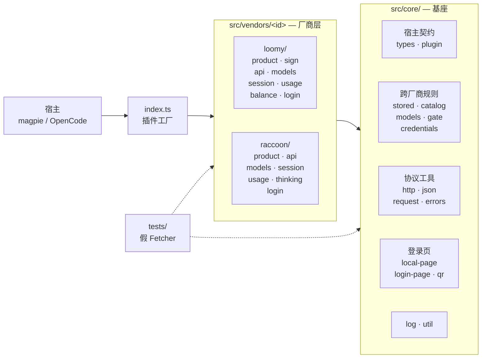

# 架构

这份包用**一个基座 + 每家厂商一个目录**的方式，把多家国内厂商的订阅账号接进
magpie（OpenCode 形状的插件宿主）。本文说明分层、边界和几个共用决定的理由；
具体协议事实见 [`vendors.md`](./vendors.md)，编码规则见
[`conventions.md`](./conventions.md)，加新厂商的步骤见
[`developing.md`](./developing.md)。

## 1. 为什么是 provider 插件

方案评审（V2）的结论：两家厂商的能力——登录取凭据、按账号续期、按账号拉模型表、
读积分、每日签到——都需要网络、跨请求状态和宿主能力。middleware 跑在网关进程的
受限执行环境里（只注入 `console`，请求钩子 250ms、无 `fetch`、无定时器、不能落盘），
承载不了这些。因此：

- 每家有差异的逻辑都落在自己的 provider 插件里（`auth` / `provider` / `config` 钩子）；
- 本包**不含 middleware**，也不靠 middleware 注入私有 wire 字段（magpie 会重建
  聊天请求体，middleware 注入的 `extra_body` 会被丢弃）。

## 2. 目录分层

```
index.ts                 入口：只导出插件工厂（见 §3）
src/core/                基座：与宿主契约、与厂商无关的能力
src/vendors/loomy/       讯飞 Loomy
src/vendors/raccoon/     商汤小浣熊
tests/                   bun test；用离线 fetcher 驱动，不发真实请求
scripts/check.ts         入口形状门禁（随 bun run verify 执行）
```

依赖方向是单向的，`scripts/check.ts` 与代码评审都以此为准：



- `src/core/**` **不 import** `src/vendors/**`：基座不知道厂商存在。
- `src/vendors/<a>/**` **不 import** `src/vendors/<b>/**`：两家厂商互不依赖，
  共用能力下沉到 `core`，而不是横向复用。
- 只有 `src/vendors/<id>/index.ts` 组装 `defineVendor`；同目录的其他模块不碰宿主
  契约，只接收 `Fetcher` 和普通数据，因此可以在没有宿主的情况下单测。

前两条由 `bun run check` 机械校验（扫描 import 并解析相对路径），违反直接失败：
把共用逻辑往 `core` 下沉，或在 `core` 里 import 厂商，都会在提交前红。

### `src/core/` 的模块职责

| 模块 | 职责 |
|---|---|
| `types.ts` | 宿主契约的类型（`Hooks`、`AuthMethod`、`StoredAuth`、`UsageWindow`…），全部按"字段可能缺失"读取 |
| `plugin.ts` | `defineVendor`：把厂商定义装配成宿主要的 `{ config, auth, provider }` |
| `stored.ts` | 登录态的两种存储形状与统一读法（见 §4.6） |
| `catalog.ts` | `provider.models` 的三条宿主规则（空目录=没话说、读失败=标记回退、登录态被拒=上抛） |
| `http.ts` | 基于宿主 `fetch` 的超时、JSON 读取与统一的 `HttpTransportError` |
| `json.ts` | 防御式读取器（`str` / `num` / `asObject`…），所有远端字段都经它取值 |
| `models.ts` | `ModelSpec` → 宿主的两种模型形状（`config` 与 `provider.models`），倍率、`variants`、回退标记 |
| `errors.ts` | 错误taxonomy：`VendorError`（请求级失败）与 `SignInExpiredError`（登录态失效） |
| `credentials.ts` | 厂商自有常量（AccessKey、手机号加密密钥）的取值顺序与缺失语义 |
| `request.ts` | `patchingJsonBody`：聊天请求体的厂商方言改写 |
| `gate.ts` | 宿主侧拒绝：`quotaRefusal` / `gatedFetch`，形状落在宿主的 `failQuota` 判定上 |
| `local-page.ts` | 回环登录页服务器（`127.0.0.1:0` + 随机路径前缀） |
| `login-page.ts` | 登录页的 HTML 骨架与页面侧运行时（`cnStatus/cnPost/cnPoll/cnDone`） |
| `qr.ts` | 零依赖 QR 编码器（字节模式、纠错 M、版本 1–10） |
| `log.ts` | 唯一的日志出口，写失败自我吞掉 |
| `util.ts` | 随机串、手机号打码、HTML 转义、一次性 settlement、`sleep` |

### 厂商目录的模块职责

| 模块 | 职责 |
|---|---|
| `product.ts` | 该厂商的常量事实：域名、路径、错误码、超时、凭据规格、回退模型表 |
| `api.ts` | 该厂商的 HTTP 方言：信封解析、请求头、每个端点的读写函数（接收 `Fetcher`） |
| `models.ts` | 远端模型目录 → `ModelSpec[]`，以及回退表 |
| `session.ts` | 登录态在账号里的读写（`access`/`key`、组织码、账号名） |
| `usage.ts` | 额度 → `UsageWindow[]` / `UsageReport`（含签到结果映射） |
| `login.ts` | 登录方式（`AuthMethod[]`）与本地页流程 |
| `balance.ts` | 带 TTL 的额度读数缓存，以及"锁定永久积分"的请求门禁（只有需要时才存在） |
| `sign.ts` / `thinking.ts` | 该厂商独有的签名或 wire 方言（只有需要时才存在） |
| `index.ts` | 唯一的装配点：`defineVendor` 定义 provider |

## 3. 与宿主的边界

Magpie 加载一个插件目录时会取其中一个入口文件，并对该模块的
**每一个函数导出**调用一次，把结果当作插件（`internal/plugin/host.js` 的
`servers()`）。因此：

- `index.ts` **只导出插件工厂**，不导出工具函数、常量或类型值；
- 同一个包可以导出多个工厂（本包导出 `LoomyAuthPlugin`、`RaccoonAuthPlugin`），
  它们共享同一个 magpie 条目的 `options` 对象——**选项键必须带厂商前缀语义**
  （`accessKeyId` 属 Loomy，`phoneCipherSecret` 属 Raccoon），不得互相覆盖；
- `scripts/check.ts` 把这条规则做成门禁：入口导出必须都是函数，导出名必须以 `AuthPlugin` 结尾
  （`<Vendor>AuthPlugin`），且每个工厂都能装配出合法的钩子形状。工厂函数自身的名字恒为
  `vendorAuthPlugin`——厂商 id 要等 setup 运行才知道，与其取一个可能对不上的名字，不如让导出名
  做身份；两者不同时门禁会把两个名字都打印出来。

`defineVendor` 是**唯一**接触宿主契约的地方，它把每个厂商定义映射成：

直接 OpenCode 使用 `opencode/loomy.ts` 或 `opencode/raccoon.ts`，每个子入口只暴露一个
`default.server`。这是有意的宿主边界：OpenCode 的公共插件契约不消费 Magpie 的
`usage`、`checkin`、`refresh` 和账号 metadata 扩展，不能把根入口的两个 Magpie 工厂
误当成 OpenCode 的一个通用 server。

```
config(config)        → config.provider[id] ??= { name, npm, api, models }
auth.provider/id      → 账号归属（magpie 用 `<id>/<accountId>` 记账）
auth.methods          → 登录方式（oauth / api）
auth.loader           → 每次登录态变化后重跑，产出 chat 请求的 baseURL/apiKey/headers/fetch
auth.refresh(+lead)   → 到期前的续期（仅 oauth 形状 + 有 refresh 的厂商）
auth.usage            → 额度卡片
auth.checkin          → 每日签到（没有端点的厂商不实现）
provider.models       → 该账号可见的模型列表
```

几条容易踩的宿主语义（都已在基座里处理）：

- `client.auth.set` 是**整体替换**，不是合并：写回账号时必须从 `getAuth()` 的结果
  出发复制，否则会把 `access`/`expires` 写没（见两个厂商的 `session.ts`）。
- `auth.loader` 的结果会被缓存，登录态变化时失效重跑；因此 loader 要便宜、无副作用。
- `auth.refresh` 的返回值是**合并**到已存登录态上的：不返回的字段保持原值。所以
  轮转型厂商必须显式回写新的 `refresh`；而"没有到期时间"要用 `expires: 0` 表达
  （宿主按 `expires > 0` 判断要不要续期），不能省略——省略会保留旧到期时间，
  于是每次请求都续期一次。
- 登录结果里带 `refresh` 字段 → 按 OAuth 形状存储（可续期）；只有 `key` →
  按 API key 形状存储（宿主不会也不能续期）。

## 4. 六个跨厂商共用的决定

### 4.1 只改自己那一层：wire 方言放在 `loader.fetch`

厂商私有的请求字段（Raccoon 的 `extra_body.thinking`）用 `patchingJsonBody`
包在 loader 返回的 `fetch` 上。`core/request.ts` 保证：

- body 不是 JSON 文本、或 patch 返回 `undefined` → **原样透传**，不重新序列化
  （重新序列化会改变 key 顺序与空白，影响上游的 prompt 缓存视角）；
- 只有确实要改写时，才删掉 `content-length` 并写入新 body。

### 4.2 登录页只做 UI，密钥不进页面

扫码/短信都需要一个页面：`PageServer` 绑 `127.0.0.1:0`，URL 带 16 字节随机前缀，
由发起流程的一方负责关闭。页面侧只拿得到"状态"和"提交表单"两个接口：

- 二维码只以 SVG 形式出现在页面里，**code 本身留在插件进程**；
- 手机号加密在插件进程内完成，页面既不持有密钥也不落盘；
- 页面脚本、样式由 `login-page.ts` 统一渲染，厂商只提供文案与少量片段。

### 4.3 厂商自有常量走 options/env，缺失即关闭该方法

AccessKey、手机号加密密钥这类值属于厂商客户端，不属于本包：
`credentials.ts` 按 **插件选项 → 环境变量** 取值；取不到就让依赖它的登录方式
**不出现**（而不是让用户填完表单才失败）。错误信息里给出选项名和环境变量名。

### 4.4 额度只说服务说过的

`UsageWindow.used` 会被宿主用来排序账号，因此只在**上限已知**时才计算百分比；
上限未知的池子一律 `aside: true`（卡片照常展示，不参与路由与排序）。
回退模型表用 `markFallback` 标记，界面据此说明"这不是账号的真实列表"。

### 4.5 要拦住一个请求，就用宿主认得的形状拒绝

额度窗口能排序，但不能**硬排除**一个账号：只有上限已知的窗口才参与选号，而
厂商的规则有时比这更强（Loomy 锁定永久积分时，"今日额度用完"意味着完全不可
用）。这类规则落在 `loader.fetch` 里 —— 但 loader 的结果会被宿主缓存到登录态
变化为止，所以判断要放在每次请求都跑的那一层：`gatedFetch(fetch, refusal)`。

拒绝本身必须是宿主读得懂的：`core/gate.ts` 用 429 + 含"额度"措辞、且不含
"余额/充值"与限流措辞的正文，让 `failure()` 落到 `failQuota`，账号才会被 bench
到**窗口重置**而不是歇固定时长。规则与文案的对应关系有测试盯着
（`tests/core.gate.test.ts`），改文案要连测试一起改。

### 4.6 登录态的两种存储形状，用一处读法收住

`client.auth.set` **整体替换**账号，存回来的形状却取决于登录结果
（`internal/plugin/host.js` 的 `save`）：

| 登录结果 | 宿主存下的形状 | 附加字段的位置 |
|---|---|---|
| 带 `refresh`（OAuth） | `{ type: "oauth", access, refresh, expires, … }` | 顶层 |
| 只有 `key`（API key） | `{ type: "api", key, metadata: { … } }` | **`metadata` 里** |

于是"同一个账号，换一种登录形状，附加字段就换个地方"：直接读 `auth.officeIdentity`
的代码在 OAuth 形状下正确，在 API key 形状下读到 `undefined`，而且不会报错——
它只是安静地少了一个值。`core/stored.ts` 把读法收在两处（`storedSession` /
`storedField`），厂商的 `session.ts` 一律经它们取值。

这不是理论风险：Raccoon 在服务端不发 `refresh_token` 时正好按 API key 形状
存储，组织码读丢之后请求会打到个人账号（`X-Org-Code` 为空），而账号名也会退
回服务端自动生成的默认值。

### 4.7 图标：一个包两个 provider，图标必须由各自的 `auth.icon` 给出

图标有两条互不相通的通道，规则不同：

| 通道 | 谁读 | 接受什么 | 本包的落点 |
|---|---|---|---|
| `auth.icon` | provider 行、账号、额度卡片 | **只有** `https://` 图片网址或 `data:image/` URI（图片本身 ≤ 1 MB） | 各厂商 `product.ts` 的 `LOOMY_ICON` / `RACCOON_ICON`，经 `defineVendor` 的 `icon` |
| `registry.json` 的 `icon` | 插件市场卡片、插件行 | 社区内置图标名（`internal/gui/assets/icons/<name>.svg`） | 一个包一个值，只能代表一家（见 `developing.md` §4.1） |

**关键点在于 `auth.icon` 只接受网址或 data URI**：写 `spark-color` 这类内置
图标名不会报错，宿主 `iconOf` 直接把它丢掉（`internal/plugin/host.js`），界面上
只是没有图标。已实测确认（magpie `0.1.1137`，2026-10-09）：把 `LOOMY_ICON` 临时
改成一个裸名字，`plugin --json` 里 loomy 的 `icon` 字段就消失了。因此这条已经做成
门禁（`scripts/check.ts` 的 `checkIcon`），而不是只写在这里。

**为什么图标指向厂商自己托管的图片，而不是提交一份进仓库**：品牌资源放进仓库会
带来授权与维护问题（厂商换标后本地副本就过时了），而宿主本来就支持直接取网址。
代价是图片可能失效——失效时宿主回落到市场图标，只损失一个图标，不影响 provider
的加载与功能，所以这个取舍是安全的。

**一个包里的两个 provider 必须有各自的图标**：包级的 `package.json` 的
`magpie.icon` 是「这个包里没自己声明图标的 provider」共用的兜底值，用它作两家
厂商的图标就等于两家都画错。图标按 provider 声明后，一家配错不影响另一家
（实测时正是这样：只有被改的那一家丢了图标）。

## 5. 主要数据流

**登录（扫码）**：`authorize()` → 启动本地页与轮询 → 用户扫码 → 轮询拿到
`access`（+ `refresh`）→ `learn()` 补齐账号名/组织 → `SignInResult` → 宿主存储并
重跑 loader。

**聊天请求**：宿主取账号 → loader（session/headers/fetch 包装）→ 宿主组装请求 →
厂商 fetch 包装按需改写 body → 厂商 API → 响应原样回到宿主。宿主在聊天链路上按
HTTP 状态判断登录态（401 标记失效、2xx 清除），插件在这一层不改写信封。403
**不要**翻译成失效：它不是「认证失败」的同义词（额度、权限、安全策略、地域限制
都用它），一刀切会把别的问题误报成需要重新登录 —— 理由与实测出处见
`vendors.md` §4 第 8 条。

登录态失效的正常上报路径是 `usage` / `provider.models` / `auth.checkin`：见到厂商的
失效码就返回 `signIn: "expired"` 或抛 `SignInExpiredError`，宿主据此标记账号。

**模型列表**：`provider.models` → 远端目录（按账号）→ `ModelSpec[]` → 宿主模型
形状；读失败 → 回退表 + `markFallback`；登录态失效 → 抛出并标记账号。

**额度与签到**：`auth.usage` 只读；`auth.checkin` 只在对端幂等时实现
（Loomy 有 `/points/first-login`，Raccoon 服务端自动发放、无端点，因而不实现）。
Loomy 的当日上限只有签到应答会说，因此签到与 usage 都把它写进账号
（`session.ts` 的 `rememberQuota`），下次 usage 读回它、今日窗口才参与选号
（`usage.ts` 的 `quotaForNow`）；属于已经重置那一天的上限会被丢掉，不带到
新的一天。

**续期**：只有 Raccoon 有（`auth.refresh` + `refreshLead`）。Loomy 没有续期端点，
到点由宿主标记失效、用户重新登录——不实现假的续期。

## 6. 刻意不做的事

- **不做 middleware**（见 §1）。
- **不代管浏览器/不读用户浏览器 cookie**：登录要么是厂商的开放流程，要么是本地页。
- **不静默执行有副作用的动作**：新手任务领奖之类没有对应钩子的行为不做，只在文档
  里说明去哪里领。
- **不引入运行时依赖**：只用 Node/Bun 内置模块（`node:crypto`、`node:http`），
  QR 编码器等能力自带实现（见 `THIRD_PARTY_NOTICES.md`）。
- **不自建缓存或落盘**：唯一的持久状态是宿主的账号存储；插件内部的缓存必须能从
  账号数据重建。

## 7. 命名与身份

| 身份 | 值 | 说明 |
|---|---|---|
| npm 包名（发布时） | `@magpie-community/opencode-cn-ai-auth` | 社区 registry 与发现机制用 |
| 独立仓库/目录 | `opencode-cn-ai-auth` | 本地开发用裸名 |
| 社区 monorepo 目录 | `packages/cn-ai` | 跟随短名 |
| provider id | `loomy`、`raccoon` | 写进账号 key（`<id>/<accountId>`），一旦发布不可随意改 |
| 日志 service | `cn-ai` | `core/log.ts` 统一写 |

provider id 是账号归属与模型 `providerID` 的一部分，改名等于让所有已登录账号失联；
新增厂商只**追加** id 与导出，不动既有的。
